  

  <a href="#capstone">Capstone</a> &nbsp;·&nbsp;
  <a href="#every-layer">Every layer</a> &nbsp;·&nbsp;
  <a href="https://www.linkedin.com/in/mohamed-hossam-762736221">LinkedIn ↗</a> &nbsp;·&nbsp;
  <a href="https://caraxesmsc.github.io">Portfolio ↗</a> &nbsp;·&nbsp;
  <a href="mailto:mohamedongo21@gmail.com">Email</a>

  

A GitHub Action rebuilds this every day from my real contribution calendar. Most of it lands in private repos for production systems I run day to day.

Computer & Systems Engineering graduate, **Ain Shams University × University of East London** (2026). I've designed a CPU in VHDL, changed the MINIX 3 scheduler, written a compiler front-end, and shipped cloud apps. For my capstone with **Siemens Egypt** I built the safety layer that lets an LLM edit a live engineering model.

I like systems where you can follow the signal from the hardware up through every layer.

## ◆ Capstone: an AI copilot that can't break the model

  

**AI-Powered MBSE Copilot for Eclipse Capella**, built with the AE Team at Siemens Egypt and presented at the ASU graduation showcase.

- **I owned the AI-facing layer:** the MCP server in Python, which handles task planning and request validation. It talks over **Py4J** to a Java process running inside Capella.
- **I built a control gateway that checks every AI-generated change** before it touches the live model. It enforces layer isolation, validates dependencies, blocks duplicate elements and wraps edits in transactions. It is a guardrail for a regulated engineering tool, not just a wrapper around an LLM.
- **I made it reproducible:** a Dockerized environment and a deterministic testbench, so the assistant gives the same result on every run and not just once in a demo.

`Python` `MCP` `LLM orchestration` `RAG` `Py4J` `Java` `Eclipse Capella` `Docker` `MBSE`

Code is under NDA. I'm happy to walk through the architecture on a call.

## ◆ Every layer, built by hand

University projects ordered by layer, from the hardware up. Most course repos are private, so 🔒 means I can show a walkthrough on request.

| Layer | Project | What I built | Code |
|:--|:--|:--|:--:|
| **Gates** | ATM Bank System | Led two sub-teams through a **full ASIC flow**: RTL, simulation, synthesis and formal verification. | [repo ↗](https://github.com/caraxesmsc/EDA-ATM-Bank-System-Verilog) |
| **CPU** | MIPS Processor | Harvard-architecture MIPS in **VHDL** built from scratch: ALU, control unit, register file and memory. | 🔒 |
| **Kernel** | MINIX 3 Scheduling & Paging | Custom CPU scheduling and memory paging written inside the real **MINIX 3 kernel** source tree and benchmarked, not simulated. | 🔒 |
| **Compiler** | C-like Language Front-end | Lexer and **recursive-descent parser** in C++ that produce ASTs, with a GUI tree visualiser. | 🔒 |
| **Runtime** | C Performance Monitor | Header-only **C instrumentation** library that traces call hierarchies and timing, with a Python report generator. | [repo ↗](https://github.com/caraxesmsc/SPE_Project_21p0254) |
| **Intelligence** | AI Algorithms Analysis Platform | Benchmarks Minimax, α-β pruning, **Deep Q-Learning** and RL across game environments, with live reward curves. | 🔒 |
| **Cloud** | University Management System | **Django** app with Firebase, role-based access and full UML documentation, deployed to **GCP** through GitHub Actions CI/CD. | 🔒 |

<b>Earlier foundations</b>

 

- [Memory Matching Game](https://github.com/caraxesmsc/MemoryMatching-CardGame-DataStructure): stacks, queues and dynamic allocation in an interactive C++ game.
- [Library System](https://github.com/caraxesmsc/LibrarySystemProject): object-oriented Java and JavaFX catalogue.
- [Movie Library Viewer](https://github.com/caraxesmsc/MovieLibraryViewer): Python desktop media manager.
- [Training-NEXT-Fullstack](https://github.com/caraxesmsc/Training-NEXT-Fullstack): Laravel full-stack work from my internship at NEXT Academy (Oracle).

## ◆ Recognition

- 🏆 **Winner, Central Bank of Egypt FinYology (2025):** an AI-powered digital wallet for children under 16, chosen over university teams from across Egypt.
- 🛰️ **Siemens Egypt AE Team:** industry collaboration on the capstone above.
- 🛡️ **Cisco CyberOps Associate (2024)** · **Full-Stack Web Developer, NEXT Academy by Oracle (2023)**

## ◆ Toolkit, by layer

**Hardware** &nbsp; Verilog · VHDL · MIPS assembly · ASIC flow · formal verification 
**Systems** &nbsp; C · C++ · MINIX 3 · compilers · Linux 
**AI** &nbsp; Python · LLM orchestration · agentic pipelines · MCP · RAG · Hugging Face · Deep Q-Learning 
**Software & cloud** &nbsp; Java · Django · Laravel · SQL · Firebase · GCP · Docker · GitHub Actions

 

<b>FROM GATES TO AGENTS.</b>

