  <picture>
  <source media="(max-width: 600px) and (prefers-reduced-motion: reduce)" srcset="./assets/hero-mobile-static.svg" />
  <source media="(prefers-reduced-motion: reduce)" srcset="./assets/hero-static.svg" />
  <source media="(max-width: 600px)" srcset="./assets/hero-mobile.svg" />
  
  </picture>

  <a href="#about">About</a> &nbsp; · &nbsp;
  <a href="#public-work">Public work</a> &nbsp; · &nbsp;
  <a href="#toolkit">Toolkit</a> &nbsp; · &nbsp;
  <a href="https://github.com/caraxesmsc?tab=repositories">Explore repositories ↗</a>

<b>I turn complicated workflows into useful software.</b> 
Full-stack development, practical AI, and a little creative experimentation.

## 01 / Behind the handle

I'm **Mohamed Hossam Abdelalim**, also known as **caraxesmsc**.

I like building things that earn their place in someone's day: a clearer interface, a useful tool, or an automation that removes a repetitive task. My interests connect web development, AI, and the craft of making software easier to use.

  <picture>
  <source media="(max-width: 600px)" srcset="./assets/console-mobile.svg" />
  <source media="(prefers-reduced-motion: reduce)" srcset="./assets/console-static.svg" />
  
  </picture>

## 02 / The public workbench

A few earlier projects you can explore, from desktop software to hardware design.

### [Movie Library Viewer ↗](https://github.com/caraxesmsc/MovieLibraryViewer)

**A home for the movies already on my PC.** A Python application for browsing downloaded movies in a library view.

`Python` · `Desktop application` · `Personal utility`

### [Library System ↗](https://github.com/caraxesmsc/LibrarySystemProject)

**An exercise in organizing more than books.** A Java library-system project built for an object-oriented programming course.

`Java` · `Object-oriented programming` · `Course project`

### [ATM Core Design & Verification ↗](https://github.com/caraxesmsc/EDA-ATM-Bank-System-Verilog)

**A look beneath the application layer.** A team project exploring an ATM core in Verilog, with design models and a verification environment.

`Verilog` · `Digital design` · `Verification`

<b>More from the archive</b>

- [Full-stack training](https://github.com/caraxesmsc/Training-NEXT-Fullstack) — PHP coursework and practice.
- [Memory matching card game](https://github.com/caraxesmsc/MemoryMatching-CardGame-DataStructure) — C++ and data structures.
- [Football Association DB](https://github.com/caraxesmsc/FootballAssociationDB) — a C++ project from the archive.

## 03 / Tools of the trade

**Web & applications** &nbsp; TypeScript · JavaScript · React · Next.js · Node.js

**Data & automation** &nbsp; Python · Firebase · Git

**Foundations** &nbsp; Java · C++ · SQL · Verilog

 

  <b>Have a look around.</b> 
  <a href="https://github.com/caraxesmsc?tab=repositories">Explore the code</a> &nbsp; · &nbsp;
  <a href="https://github.com/caraxesmsc?tab=stars">See what catches my attention</a>

  <b>KEEP THE CURIOSITY. SHIP THE IDEA.</b>

